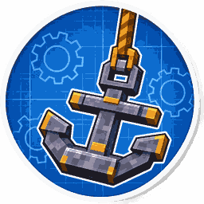

  
  <h1>Create: Heavy Anchor</h1>
  
<strong>A reusable 10-ton physics anchor for Create Aeronautics.</strong>

  
Minecraft 1.21.1 · NeoForge · Version 1.2.5

---

Create: Heavy Anchor adds a reusable deployable anchor for Create Aeronautics / Simulated physics contraptions. It connects to the standard Rope Winch and Rope Coupling and can become extremely heavy when it reaches the ground.

## Features

- **Reusable anchor block** with a custom 3D model.
- **Native rope compatibility** with the standard Simulated / Aeronautics Rope Winch and Rope Coupling.
- **Automatic anchoring:** ground contact switches the anchor to 10,000 kpg.
- **Lightweight retrieval:** the anchor returns to 0.25 kpg over 60 game ticks (about 3 seconds at 20 TPS), rather than releasing its mass instantly.
- **Two wireless control frequencies:** configure weight ON and weight OFF using Shift + right-click and normal Create Redstone Links. Frequency items are not consumed.
- **Engineer's Goggles overlay:** shows the current mode, mass and release countdown.
- **Stable hanging:** low center of mass, rope clearance and motion damping reduce unwanted movement while suspended.
- English and German localization.

## Installation

1. Install Minecraft **1.21.1** with **NeoForge 21.1.267**.
2. Install the required dependencies listed below.
3. Download heavyanchor-1.2.5.jar from the [GitHub Releases](../../releases/latest) page.
4. Put the JAR into your mods folder and launch the game.

For multiplayer, install the mod and its dependencies on both the client and server. Dedicated-server behavior has not yet been verified.

## How to use

1. Place the Heavy Anchor block.
2. Assemble it as its own independent physics object using the Aeronautics assembly tools. Do not merge it into the airship's main physics body.
3. Connect a standard Rope Coupling from the Rope Winch to the anchor.
4. Lower the anchor until it touches terrain. It will switch to heavy mode.
5. Retrieve it by winding the rope up. In automatic mode, its mass decreases smoothly over approximately three seconds.
6. To use manual control, Shift + right-click the anchor, set separate frequencies for **Weight ON** and **Weight OFF**, then use matching Create Redstone Links.

Leave enough clearance below the vehicle for the anchor and rope.

## Compatibility

The following stack was used for local in-game testing:

| Component | Tested version |
|---|---:|
| Minecraft | 1.21.1 |
| NeoForge | 21.1.267 |
| Create | 6.0.10 |
| Create Aeronautics | 1.3.3 |
| Create Simulated | 1.3.3 |
| Sable | 2.0.6 |
| Veil | 4.5.2 |

Other versions may work but have not been verified. The mod requires Create, Simulated, Sable and Veil to be installed.

## Building from source

Requirements:
- Java 21
- Gradle wrapper included in this repository
- The exact dependency JARs listed in libs/README.md

Place the dependency JARs in libs/, then run:

    ./gradlew build

The built mod will be at build/libs/heavyanchor-1.2.5.jar.

The third-party dependency JARs are intentionally not committed to this repository. Obtain them from their respective official project pages.

## Credits and license

Create: Heavy Anchor is an unofficial community add-on and is not affiliated with or endorsed by the Create or Create Aeronautics teams.

The rope simulation, persistence and client rope-rendering foundation are adapted from [Create: Towed by JxstFeli](https://github.com/TheReal-Flo/Create-Towed), under its MIT License. The original license and attribution are retained in this repository and in the distributed mod JAR.

The required Create, Aeronautics, Simulated, Sable and Veil projects are separate third-party dependencies and are not bundled here.
